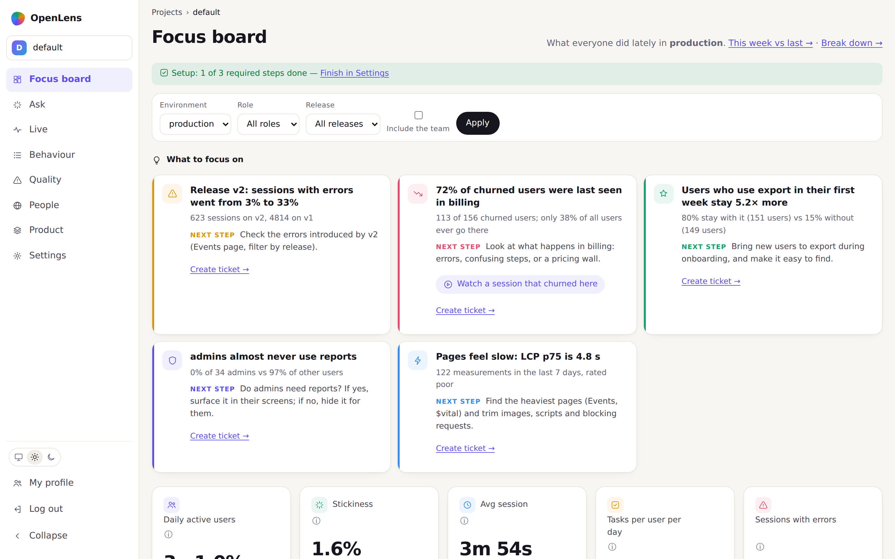
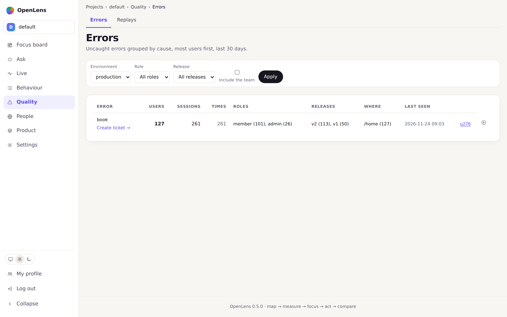
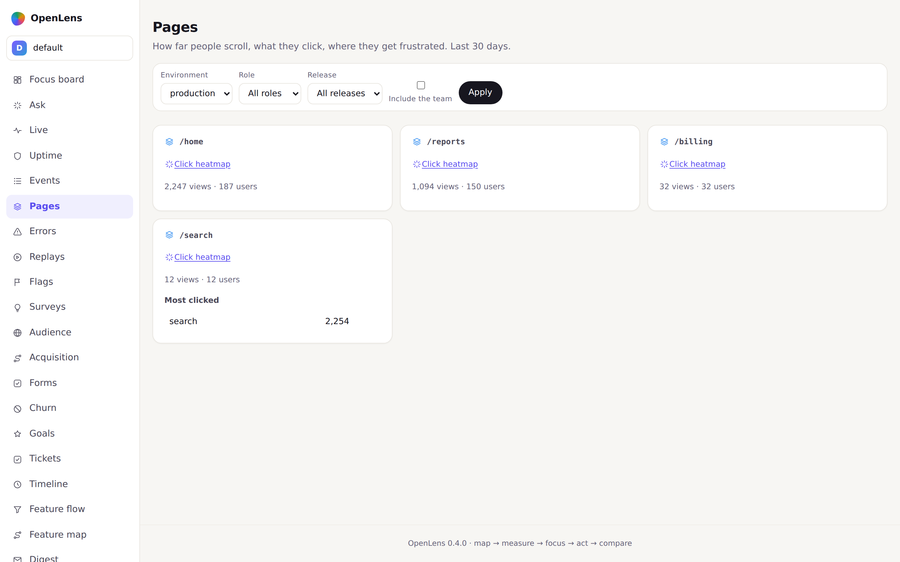

<div align="center">

# 🔭 OpenLens

**Product analytics as a method, not a toolbox.**<br>
Your agents wire it in. Your PM opens a board that already says where the value is.

[](https://github.com/Philippe-arnd/OpenLens/actions/workflows/ci.yml)
[](https://github.com/Philippe-arnd/OpenLens/actions/workflows/release.yml)
[](LICENSE)


**map → measure → focus → act → compare** · [the method](docs/method.md) · [roadmap](ROADMAP.md) · [agent guide](docs/agents/wire.md)

</div>

<picture>
  <source media="(prefers-color-scheme: dark)" srcset="docs/img/board-dark.png">
  
</picture>

## ✨ What you get

On first login, the **Focus board** is already populated. It answers what product managers actually ask:

- 🎯 **What to focus on.** Three to seven ranked insight cards, each with its evidence, its cohort size and a next step:
  - *"Users who use export in their first week stay 5.2× more"*
  - *"72% of churned users were last seen in billing"*, with a ▶ link to watch one of those sessions
  - *"admins almost never use reports"*
  - *"Release v2: sessions with errors went from 3% to 33%"*
- 👥 **Who does what.** Every KPI by **role** (canonical roles, mapped from your app's raw values), account and plan. A *roles × features* grid shows blind spots at a glance.
- 📈 **KPIs that matter.** These are the [definitions](docs/kpis.md):
  - DAU/WAU/MAU, stickiness, users who came back, session length, tasks per user
  - error rate and Core Web Vitals
- 🧩 **Feature pulse.** Per feature: adoption, uses per user, active days, completion, and task time (median and p90).
- 🔁 **Do they come back?** Weekly retention cohorts.
- 🛣️ **Journeys and funnels.** The paths that lead to each feature's success event, and the steps where people drop off.
- 🚀 **Release vs release, environment vs environment.** Every event carries its release, so the board tells you whether the last change moved the number.
- 🚩 **Feature flags.** Roll out by percentage, role or account. Each flag becomes its own cohort on the board (*with vs without*).
- 🎬 **Session replay.** Inputs are always masked. Replays are linked from events, errors and churn cards.
- 🐞 **Errors.** Grouped by cause, split by role, release and page. Each group links to its replay and, with source maps, to the original file and line.
- 🔥 **Pages.** Scroll depth, most-clicked elements, rage clicks.

## 🤖 Zero human setup

OpenLens is built for apps that agents write and maintain. **Your coding agent does the wiring**, following [`/agents.md`](docs/agents/wire.md), which every server serves:

1. `openlens-cli init`: creates the project.
2. It adds the snippet and `identify(user.id, { role })` with your real role field.
3. It drafts `openlens.features.yaml`, the **feature map**: your features, their entry points and their *success* moment, plus your roles. It then lints the map against the code.
4. It **backfills** history from your database, so day one already shows months of signal.
5. `openlens-cli verify`: green. Then `openlens-cli login-link` → 📩 to the PM.

From then on, agents keep the map current, and they can ask OpenLens anything over **MCP**:
- `insights`, `kpi_report` (split by role, account, plan, page or feature) and `user_timeline`;
- `errors`, read-only `sql`, `flags`, …

## 🔌 One dependency, any stack

```html
<!-- server-rendered apps: one tag -->
<script src="https://lens.example.com/c.js" data-key="pk_…" data-release="v1.4.2" defer></script>
```

```js
// SPAs: npm install @openlens/web
import openlens from "@openlens/web";
openlens.init({ host: "https://lens.example.com", key: "pk_…", release: BUILD_SHA });
openlens.identify(user.id, { role: user.role, account: user.orgId, plan: user.plan });
```

- **Captured automatically:** page views and SPA routes, clicks (named by `data-feature`), forms, errors, Web Vitals, failed requests, scroll depth, environment and release.
- **Privacy:**
  - no cookies;
  - input values are never captured;
  - Do Not Track and consent are respected;
  - `data-openlens-mask` and `data-openlens-block` give finer control over what replay records.
- **Size:** the core SDK is **3.8 kB** gzipped. The replay recorder loads separately, only once the page is idle.

Two complete examples, both wired by following the agent guide, live in [`examples/`](examples/). Every night, CI clicks through them in Chromium and requires a green `verify`.

## ⚡ Try it in two minutes

```sh
cargo xtask demo ./data                                   # 300 synthetic users with planted patterns
OPENLENS_DATA_DIR=./data OPENLENS_ADMIN_TOKEN=demo cargo run -p openlens
# → http://localhost:8686, token "demo"
```

**Deploy:** use the one-click [Coolify template](docs/deploy/coolify.md). There are no required environment variables, and the admin token generates itself. Back up with `openlens backup <dir>`, which is safe while the server runs.

## 🪶 Why it is lean

| | |
| --- | --- |
| 📦 **One binary** | API, ingestion, dashboard and retention in one Rust process. No Kafka, ClickHouse or Redis. |
| 🗂️ **Files you own** | WAL → daily Parquet (zstd), about 11 bytes per event. Metadata lives in SQLite. One directory to back up. |
| 🏎️ **Fast on small boxes** | About 80k events/s ingested on **one vCPU**. The board answers in ~1 s on 500k events ([benchmarks](docs/benchmarks.md)). |
| 🔒 **Locked down** | The dashboard has no JavaScript and a strict CSP (only the replay page runs a script, its own). There are no `unwrap`/`panic` calls in production code, and every input is treated as hostile. |
| 🧘 **Almost no settings** | One method, fixed KPI definitions and fixed retention (13 months of events, 30 days of replays). The feature map is the only configuration ([D-014](docs/decisions.md)). |

## 🗺️ Status

**Working, tested, not yet in production.** Milestones M0–M5 are done. M6, dogfooding on two real apps for 30 days, starts with the first deployment. See [ROADMAP.md](ROADMAP.md), [gaps](docs/gaps.md) and [parity with the category](docs/target-app-parity.md).

| | |
| --- | --- |
|  |  |

## 🧱 Layout

| Path | What |
| --- | --- |
| `apps/openlens` | The server binary: API, ingestion, dashboard, `backup`, `healthcheck` |
| `apps/openlens-cli` | Agent toolkit: `init`, `features`, `import`, `verify`, `sourcemaps`, `flags`, `export`, `sql`, `login-link`, `mcp` |
| `crates/*` | Layered engine crates ([architecture](docs/architecture.md), checked by `cargo xtask layers`) |
| `sdk/js` | Browser SDK `@openlens/web`, the replay recorder and the player |
| `sdk/node`, `sdk/python` | Server SDKs: thin HTTP clients ([sdk/SERVER.md](sdk/SERVER.md)) |
| `examples/` | Reference apps: script tag and SPA |
| `docs/` | Method, KPIs, decisions, architecture, agent guides, deploy, benchmarks, clean-room log |

## 🛠️ Develop

```sh
cargo xtask ci     # fmt, clippy, tests, layers, licences: exactly what the PR gate runs
```

More in [docs/development.md](docs/development.md). Contributors and agents: read [AGENTS.md](AGENTS.md) first.

## 🙏 Credits

The architecture is inspired by OpenObserve's public design (single binary, columnar storage, DataFusion). The working method comes from the ArtCraft team's shared contribution standards ([storytold/craft-contrib](https://github.com/storytold/craft-contrib)). This is a clean-room implementation: no code or text was copied from these projects or from any product-analytics suite ([clean-room log](docs/clean-room.md)). Session recording uses rrweb (MIT), as recorded in [ATTRIBUTION.md](ATTRIBUTION.md).

**License:** [AGPL-3.0](LICENSE).
