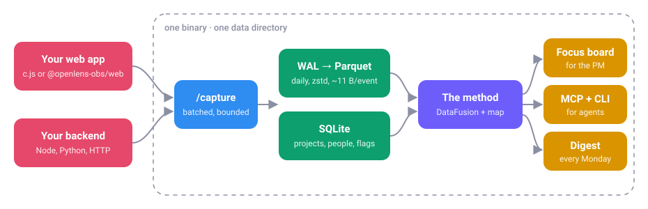

<p align="center"></p>

<h1 align="center">OpenLens</h1>

<p align="center"><b>Product analytics as a method, not a toolbox.<br>Your agents wire it in. Your PM opens a board that already says where the value is.</b></p>

<p align="center">
  <a href="https://philippe-arnd.github.io/OpenLens/demo/"><b>See the demo</b></a> (read-only, nothing to install) ·
  <a href="#-try-it-in-two-minutes"><b>Try it</b></a> ·
  <a href="#-what-the-board-answers">The board</a> ·
  <a href="#-zero-human-setup">Agents</a> ·
  <a href="#-wire-an-app">Wire an app</a> ·
  <a href="#-deploy">Deploy</a> ·
  <a href="#-how-it-works">How it works</a> ·
  <a href="#-performance">Performance</a> ·
  <a href="#-known-limits">Known limits</a> ·
  <a href="#-releases">Releases</a>
</p>

<p align="center">
  <a href="https://github.com/Philippe-arnd/OpenLens/actions/workflows/ci.yml"></a>
  <a href="https://github.com/Philippe-arnd/OpenLens/actions/workflows/k8s.yml"></a>
  <a href="https://github.com/Philippe-arnd/OpenLens/releases"></a>
  <a href="LICENSE"></a>
  <a href=".github/workflows/pages.yml"></a>
  <a href="docs/stability.md"></a>
  <a href="docs/deploy/README.md#optional-settings-d-016"></a>
</p>

OpenLens is self-hosted product analytics in **one Rust binary**: ingestion, storage, queries, dashboard and an MCP server for agents. It follows one method, **map → measure → focus → act → compare** ([the method](docs/method.md)), so there is nothing to configure.

Your coding agent wires an app in a few minutes:
1. it declares the app's features, their success moments and its roles in a small feature map;
2. it adds one script;
3. it backfills history from the app's database.

On the first login, the product manager sees KPIs **by role and by release**, and a handful of ranked insights:
- what makes users stick, and where they churn;
- which journeys lead to value;
- what the last release broke.

<p align="center">
  
</p>

<picture>
  <source media="(prefers-color-scheme: dark)" srcset="docs/img/board-dark.png?v=4cdda391b1">
  
</picture>

## 🎯 What the board answers

- **What to focus on.** Three to seven ranked insight cards, each with its evidence, its cohort size and a next step:
  - *"Users who use export in their first week stay 5.2× more"*
  - *"72% of churned users were last seen in billing"*, with a ▶ link to a replay of one of those sessions
  - *"Admins almost never use reports"*
  - *"Release v2: sessions with errors went from 3% to 33%"*
- **Who does what.** Every KPI by role, account and plan, plus a *roles × features* grid. The team's own accounts are left out.
- **KPIs with fixed definitions** ([docs/kpis.md](docs/kpis.md)):
  - DAU/WAU/MAU of identified users, and stickiness;
  - weekly retention, resurrected users;
  - sessions, bounces, tasks completed per user-day;
  - error rate and Core Web Vitals.
- **Feature pulse:** adoption, frequency, active days, completion and task time (median and p90) for every feature.
- **Journeys and funnels:** the paths into each success event, and the step where people drop off.
- **Release vs release, environment vs environment.** Every event carries its release.
- **Act on it:**
  - feature flags, each one a cohort with a significance test;
  - one-question micro-surveys after a success;
  - a weekly digest.
- **See it:**
  - session replays, with inputs always masked;
  - errors grouped by cause, with source maps;
  - scroll depth, rage clicks and click heatmaps.

## 🤖 Zero human setup

OpenLens is built for apps that agents write and maintain. Every server serves its own wiring guide at `/agents.md` ([docs/agents/wire.md](docs/agents/wire.md)):

1. `openlens-cli init` creates the project.
2. The agent adds the SDK and `identify(user.id, { role })`, using the app's real role field.
3. It drafts `openlens.features.yaml`: features, entry points, success events and roles. `features lint` checks the map against the code.
4. `openlens-cli import` backfills history, so day one already shows months of signal.
5. `openlens-cli verify` goes green. `openlens-cli login-link` is then sent to the PM, whose first login creates their admin account.

From then on, agents keep the map current. Over **MCP** (`openlens-cli mcp`) they can ask:
- `insights`, `kpi_report` (by role, account, plan, page or feature), `user_timeline`;
- `errors`, `digest`, read-only `sql`, `flags`, `surveys`.

## 🔌 Wire an app

```html
<!-- server-rendered apps: one tag -->
<script src="https://lens.example.com/c.js" data-key="pk_…" data-release="v1.4.2" defer></script>
```

```js
// SPAs and frameworks
import openlens from "@openlens/web";
openlens.init({ host: "https://lens.example.com", key: "pk_…", release: BUILD_SHA });
openlens.identify(user.id, { role: user.role, account: user.orgId, plan: user.plan });
```

- **Captured on its own:**
  - page views (History API and `#/` routes);
  - clicks named by `data-feature`, including inside web components;
  - submits, errors, Web Vitals, failed requests and scroll depth.
- **Privacy:**
  - no cookies; its state is in `localStorage`, or nowhere with `data-cookieless` ([privacy](docs/privacy.md));
  - input values are never sent;
  - Do Not Track and consent are respected;
  - `data-openlens-mask` and `data-openlens-block` for what replays may show.
- **Reliable:** failed sends are retried with the same event ids and stored once. Tabs share one session. Robots are not counted.
- **Guides:**
  - [framework recipes](docs/agents/wire.md#framework-recipes) for Next.js, Nuxt, SvelteKit, Astro, Remix, Vite and Angular;
  - [strict CSP](docs/agents/wire.md#strict-content-security-policy);
  - an [ad-blocker proxy](docs/agents/wire.md#ad-blockers-proxy-through-the-apps-domain).
- **Server events:** [Node, Python, Go, Ruby and PHP](sdk/SERVER.md) thin clients, or a plain `POST /capture`.
- **Examples:** [`examples/`](examples/) has two reference apps (script tag and npm package), which CI clicks through every night until `verify` is green. Journal, a real app wired outside this repo, is the third.

## 🌐 Try it in two minutes

```sh
cargo xtask demo ./data          # 300 synthetic users with planted patterns
OPENLENS_DATA_DIR=./data OPENLENS_ADMIN_TOKEN=demo cargo run -p openlens
# → http://localhost:8686, token "demo"
```

Or with Docker, which doesn't need a Rust toolchain:

```sh
docker run -p 8686:8686 -v openlens-data:/data ghcr.io/philippe-arnd/openlens:latest
# the log prints a one-hour owner link on first start (or pass -e OPENLENS_ADMIN_TOKEN=…)
```

## 🚀 Deploy

| Where | How | Guide |
| --- | --- | --- |
| **Docker / Compose** | one container, one volume | [docs/deploy/docker.md](docs/deploy/docker.md) |
| **Binary + systemd** | one file, `x86_64` or `aarch64` Linux | [docs/deploy/binary.md](docs/deploy/binary.md) |
| **Kubernetes** | `helm install openlens oci://ghcr.io/philippe-arnd/charts/openlens`, or `kubectl apply -k` | [docs/deploy/kubernetes.md](docs/deploy/kubernetes.md) |
| **Coolify** | one-click template | [docs/deploy/coolify.md](docs/deploy/coolify.md) |

The [self-hosting guide](docs/deploy/README.md) covers requirements, release channels, updates, backups and settings for all of them.

- The admin token generates itself.
- Optional features stay off until their variables are set: SMTP digest, LLM rewording of cards, OpenID Connect single sign-on, S3 copy.
- `openlens backup` makes a consistent copy while the server runs.

## 🔍 How it works

- **Capture.** `POST /capture` takes gzip-compressed batches and treats every field as hostile: sizes and depth are bounded, and clock skew is corrected. Events reach a **write-ahead log** (fsynced), then **daily Parquet files** (zstd). Compaction merges each day and drops resent events.
- **Metadata** lives in **SQLite**: projects, keys, people and role history, flags, surveys, users. Everything is in one directory you own.
- **Queries** run on **DataFusion**, read-only and scoped to one project, with time, memory and row caps. `events` is a view that gives each user the events they sent before logging in.
- **The method** is code, not configuration. The feature map resolves canonical roles and features in SQL. The engine computes the KPIs, insight cards, journeys, funnels, cohorts and significance tests, and each board is computed once per project and filters, then served from memory until new data lands (it shows the new data within about 20 s).
- **The dashboard** is server-rendered HTML (maud) with **no JavaScript** and a strict CSP. Only the replay player runs a script, under its own policy.
- **Agents** use `openlens-cli`, which prints JSON, and its MCP server. They drive the same commands as the dashboard.
- **The codebase** is a layered Rust workspace (`cargo xtask layers`), with no `unwrap` or `panic` in production code ([architecture](docs/architecture.md), [decisions](docs/decisions.md)).

## ⚡ Performance

Measured on 2026-11-22, on one core of a 4-vCPU VPS ([docs/benchmarks.md](docs/benchmarks.md)):

- **Ingestion:** about **80,000 events/s on one vCPU**, p99 under 9 ms (measured by hand; the nightly benchmark tracks it on GitHub's runners).
- **Storage:** about **11 bytes per event** on disk (2.3 M events took 25 MB).
- **Board:** computed in about **0.8 s on 368k events and 3.7 s on 2.2 M** (one vCPU, with identities), then served from memory until new data lands, so most page views wait for no computation. A board takes up to 4 M events of the 90-day window in memory (about 160 bytes each) when the 768 MB query memory pool can hold them, and reads the files otherwise. The [nightly benchmark](.github/workflows/perf.yml) re-measures ingestion and the board every night.
- **SDK:** **5.5 kB** gzipped. The replay recorder loads separately, once the page is idle.
- **Footprint:** one process, 256 MiB requested on Kubernetes, and no Kafka, ClickHouse or Redis to run next to it.

## 🚧 Known limits

- **One node.** The WAL and SQLite have one writer, so Kubernetes runs one replica. S3 holds a copy of closed days, not shared storage; with the opt-in cold tier, it becomes the only copy of days older than 120 days (D-032).
- **Web first.** There is no native mobile SDK yet.
- **Sessions are cut at UTC midnight** by the SDK; KPI days follow the project's time zone.
- **Small samples:** insight cards wait for at least 8 users per compared group.
- **npm:** `@openlens/web` is not on the npm registry yet (publishing is ready). Use the script tag meanwhile.

The full list, with what is planned, is in [docs/gaps.md](docs/gaps.md) and the [backlog](https://github.com/Philippe-arnd/OpenLens/milestones).

## 📦 Releases

OpenLens follows [SemVer](https://semver.org) and keeps a [CHANGELOG](CHANGELOG.md). Every merge to `main` publishes a build release, **`vX.Y.Z-YYMMDD-sha`** (for example `v0.2.0-261122-a1b2c3d`), and versions are tagged `vX.Y.Z`. Each [GitHub release](https://github.com/Philippe-arnd/OpenLens/releases) ships:
- its notes;
- Linux binaries for x86_64 and aarch64 (`openlens`, `openlens-cli`);
- the SDK bundles;
- the Helm chart;
- SHA-256 checksums.

Next to it, the image `ghcr.io/philippe-arnd/openlens:vX.Y.Z` and the chart `oci://ghcr.io/philippe-arnd/charts/openlens` are published.

The process is in [docs/development.md](docs/development.md#releasing).

## 🛠️ Develop

```sh
cargo xtask ci     # fmt, clippy, tests, layers, licences: what the PR gate runs
```

More in [docs/development.md](docs/development.md). Contributors and agents: read [AGENTS.md](AGENTS.md) first.

| Path | What |
| --- | --- |
| `apps/openlens` | The server binary: API, ingestion, dashboard, `backup`, `healthcheck` |
| `apps/openlens-cli` | The agent toolkit and MCP server |
| `crates/*` | Layered engine crates |
| `sdk/js`, `sdk/node`, `sdk/python` | The browser SDK, replay and player; the server SDKs |
| `deploy/` | Helm chart, Kustomize base, Coolify template |
| `examples/` | Reference apps |
| `docs/` | Method, KPIs, decisions, architecture, agent guides, deploy, benchmarks, clean-room log |

## 🙏 Credits

- **OpenObserve's public design** inspired the architecture: one binary, columnar storage, DataFusion.
- **The ArtCraft team's shared contribution standards** ([storytold/craft-contrib](https://github.com/storytold/craft-contrib)) shaped the way of working.
- **rrweb** (MIT) records the sessions.
- **DataFusion, Arrow, axum, maud and SQLite** carry the rest.

This is a clean-room implementation: no code or text was copied from these projects or from any product-analytics suite ([clean-room log](docs/clean-room.md), [ATTRIBUTION.md](ATTRIBUTION.md)).

## 📄 License

[AGPL-3.0](LICENSE).
